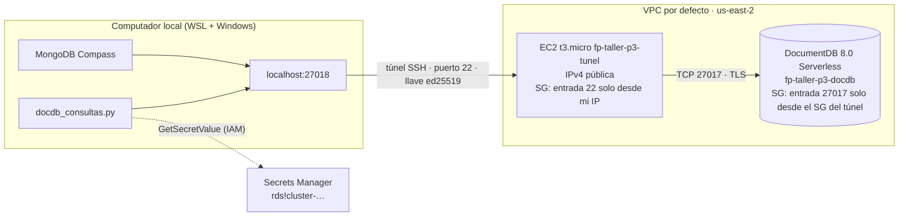

# Punto 3 — Amazon DocumentDB

Despliegue de Amazon DocumentDB Serverless en `us-east-2` (Ohio), acceso desde el computador local mediante un túnel SSH a través de una instancia EC2, conexión desde MongoDB Compass y desde Python, y consultas sobre una colección de prueba. La contraseña de DocumentDB la administra AWS Secrets Manager y el programa la recupera en tiempo de ejecución.

## Contenido

| Archivo | Descripción |
|---|---|
| `despliegue_p3.sh` | Crea, muestra y elimina la infraestructura con AWS CLI (`crear`, `estado`, `destruir`) |
| `precios_docdb.py` | Consulta los precios de DocumentDB en Ohio con la API de precios de AWS |
| `docdb_consultas.py` | Lee el secreto, se conecta por el túnel, carga los datos y ejecuta las consultas |
| `evidencias/` | Salidas de creación, ejecución y eliminación (ID de cuenta enmascarado) |
| `capturas/` | Capturas de Compass y de la consola de AWS |

## Cálculo de costos

Precios bajo demanda en Ohio, consultados con `precios_docdb.py` el 2026-11-08:

| Componente | Precio |
|---|---|
| DocumentDB Serverless Standard | $0,0822 por DCU-hora |
| `db.t4g.medium` / `db.t3.medium` | $0,0757 / $0,0780 por hora |
| Almacenamiento Standard | $0,10 por GB-mes |
| I/O Standard | $0,20 por millón de solicitudes |
| EC2 `t3.micro` | $0,0104 por hora |
| IPv4 pública | $0,005 por hora |
| EBS gp3 | $0,08 por GB-mes |
| Secreto de Secrets Manager | $0,40 por mes, prorrateado |

Comparación de cómputo de DocumentDB:

| Opción | Por hora | Por semana | Por mes |
|---|---|---|---|
| Serverless, 0,5 DCU | $0,0411 | $6,90 | $30,00 |
| Serverless, 1 DCU | $0,0822 | $13,81 | $60,01 |
| `db.t4g.medium` | $0,0757 | $12,72 | $55,26 |
| `db.t3.medium` | $0,0780 | $13,10 | $56,94 |

Costo de la práctica: los recursos estuvieron activos de 23:13 a 01:08, unas 1,92 horas. DocumentDB en su mínimo costó unos 0,079 dólares, la EC2 del túnel 0,031 y el secreto 0,001. El almacenamiento y el I/O de doce documentos son inferiores a un centavo. **Total aproximado: 0,11 dólares.** Con una `db.t4g.medium`, el mismo tiempo habría costado unos 0,18 dólares.

## Diagrama de conexión



DocumentDB no tiene endpoint público, así que el computador local no puede alcanzarlo. La EC2 sí, porque está en la misma VPC y el grupo de seguridad de DocumentDB acepta el puerto 27017 solo desde el grupo de seguridad de la EC2. El comando `ssh -L` abre el puerto 27018 en el computador local y reenvía todo lo que llega ahí, cifrado por SSH, hasta la EC2, que lo entrega a DocumentDB. Para Compass y Python, la base de datos está en `localhost:27018`. La EC2 solo acepta SSH desde la IP pública del estudiante y con la llave privada correspondiente.

Sobre ese túnel, la conexión a DocumentDB va además cifrada con TLS. El cliente valida el servidor con el certificado de AWS `global-bundle.pem` y necesita tres ajustes:

| Opción | Motivo |
|---|---|
| `tlsAllowInvalidHostnames=true` | El certificado es para `*.docdb.amazonaws.com`, pero el cliente se conecta a `localhost`. El cifrado sigue siendo válido. |
| `directConnection=true` | Sin ella, el cliente descubre los miembros del clúster e intenta conectarse a sus IP privadas, inalcanzables desde fuera de la VPC. |
| `retryWrites=false` | DocumentDB no soporta escrituras reintentables. |

## Reproducción

**Requisitos.** AWS CLI, Python 3 con `boto3` y `pymongo`, un cliente SSH y MongoDB Compass, con las credenciales de `user_cli` en el perfil `default` y la región `us-east-2`. La cuenta debe estar en el plan de pago de AWS, porque DocumentDB no está disponible en el plan gratuito.

**1. Llave SSH para la EC2 del túnel**
```bash
aws ec2 create-key-pair --key-name fp-taller-p3-llave --key-type ed25519 \
  --query KeyMaterial --output text > ~/.ssh/fp-taller-p3-llave.pem
chmod 400 ~/.ssh/fp-taller-p3-llave.pem
```

**2. Infraestructura.** El script detecta la IP pública del computador para la regla SSH.
```bash
bash despliegue_p3.sh crear
```
Crea dos grupos de seguridad, el grupo de subredes, el clúster DocumentDB 8.0.2 Serverless (0,5–1 DCU) con `--manage-master-user-password`, su instancia `db.serverless` y la EC2 del túnel. Al final muestra el endpoint del clúster, el ARN del secreto y el DNS público de la EC2.

**3. Certificado y túnel.** El túnel se deja abierto en una terminal aparte.
```bash
curl -sO https://truststore.pki.rds.amazonaws.com/global/global-bundle.pem
ssh -i ~/.ssh/fp-taller-p3-llave.pem -N \
  -L 27018:<endpoint-del-clúster>:27017 ec2-user@<DNS-público-de-la-EC2>
```
Se usa el puerto local 27018 porque en el equipo de trabajo el 27017 estaba ocupado por un servicio local de MongoDB.

**4. Compass.** Se crea una conexión con la siguiente URI, sin contraseña:
```
mongodb://taller_admin@localhost:27018/?tls=true&tlsAllowInvalidHostnames=true&directConnection=true&retryWrites=false
```
En *Authentication* se ingresa la contraseña, consultada con `aws secretsmanager get-secret-value` sobre el ARN del secreto, y en *TLS/SSL* se selecciona `global-bundle.pem` como *Certificate Authority*.

**5. Programa Python**
```bash
pip install boto3 pymongo
python3 docdb_consultas.py
```
El programa obtiene el ARN del secreto desde el propio clúster, lee la contraseña con `GetSecretValue`, se conecta por el túnel, recrea la colección `taller.pedidos` con doce documentos y ejecuta las consultas.

**6. Eliminación.** Se cierra el túnel con `Ctrl+C` y se ejecuta:
```bash
bash despliegue_p3.sh destruir
aws ec2 delete-key-pair --key-name fp-taller-p3-llave
rm -f ~/.ssh/fp-taller-p3-llave.pem
```

## Datos, consultas y resultados

La colección `taller.pedidos` contiene doce pedidos de una tienda, con cliente, ciudad, categoría, producto, cantidad, precio unitario y fecha. El campo `total` se calcula al insertar. La salida completa está en `evidencias/p3_python.txt`.

**Búsqueda con filtro.** Pedidos de la categoría Tecnología con total de al menos 1.000.000.
```python
{"categoria": "Tecnología", "total": {"$gte": 1000000}}
```
| Pedido | Cliente | Producto | Total |
|---|---|---|---|
| 1001 | Ana Gómez | Portátil | 3.200.000 |
| 1006 | Jorge Herrera | Monitor | 1.780.000 |
| 1012 | Daniel Ortiz | Tableta | 1.300.000 |

Tres de los seis pedidos de Tecnología superan el millón. El portátil es el pedido individual más costoso de toda la colección.

**Ordenación.** Los cinco pedidos de mayor valor.
```python
find({}).sort("total", -1).limit(5)
```
| Pedido | Cliente | Ciudad | Total |
|---|---|---|---|
| 1001 | Ana Gómez | Bogotá | 3.200.000 |
| 1006 | Jorge Herrera | Medellín | 1.780.000 |
| 1004 | Carlos Díaz | Bogotá | 1.450.000 |
| 1012 | Daniel Ortiz | Cali | 1.300.000 |
| 1011 | Laura Vargas | Bogotá | 650.000 |

Bogotá aparece tres veces entre los cinco pedidos más grandes, lo que anticipa su liderazgo en la agregación.

**Agregación.** Ventas por ciudad.
```python
[
    {"$group": {"_id": "$ciudad", "pedidos": {"$sum": 1}, "unidades": {"$sum": "$cantidad"},
                "ventas": {"$sum": "$total"}, "ticket_promedio": {"$avg": "$total"}}},
    {"$sort": {"ventas": -1}},
]
```
| Ciudad | Pedidos | Unidades | Ventas | Ticket promedio |
|---|---|---|---|---|
| Bogotá | 4 | 7 | 5.560.000 | 1.390.000 |
| Medellín | 3 | 6 | 2.580.000 | 860.000 |
| Cali | 3 | 9 | 2.200.000 | 733.333 |
| Barranquilla | 2 | 4 | 760.000 | 380.000 |

Bogotá concentra la mitad de las ventas con el ticket promedio más alto. Cali vende más unidades que cualquier otra ciudad, pero de productos más baratos, por lo que queda tercera en ventas.

## Problemas encontrados

**Plan gratuito.** El primer `crear` falló con `FreeTierRestrictionError`: las cuentas en el plan gratuito de AWS no pueden crear clústeres de DocumentDB. Se actualizó la cuenta al plan de pago, se eliminaron con `destruir` los recursos que alcanzaron a crearse y se repitió el despliegue.

**Puerto local ocupado.** El túnel en el puerto 27017 falló con `Could not request local forwarding`, porque un servicio local ya escuchaba en ese puerto. Se usó el 27018.

**Timeout en Compass.** El primer intento de conexión devolvió `connect ETIMEDOUT 172.31.46.181:27017`. Compass llegó a DocumentDB por el túnel, pero luego intentó conectarse a la IP privada de la instancia, que obtuvo al descubrir el clúster. Se resolvió con `directConnection=true`.

## Evidencias

| Evidencia | Archivo |
|---|---|
| Creación de la infraestructura | `evidencias/p3_crear.txt` |
| Secreto recuperado, datos y consultas | `evidencias/p3_python.txt` |
| Eliminación | `evidencias/p3_destruir.txt` |
| Conexión desde Compass | `capturas/` |

La verificación posterior a la eliminación devolvió listas vacías para clústeres de DocumentDB, snapshots de clúster, instancias EC2 activas, volúmenes EBS y secretos en `us-east-2`. La llave `fp-taller-p3-llave` también se eliminó. El secreto `rds!cluster-…` lo eliminó AWS junto con el clúster.
