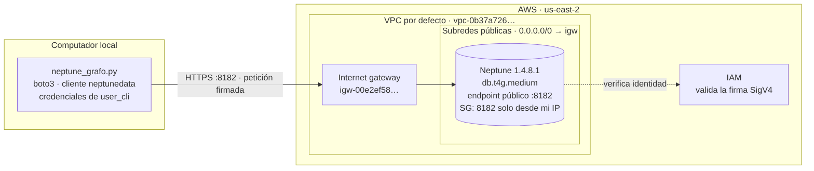
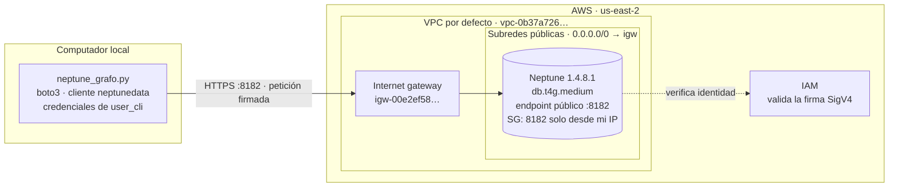
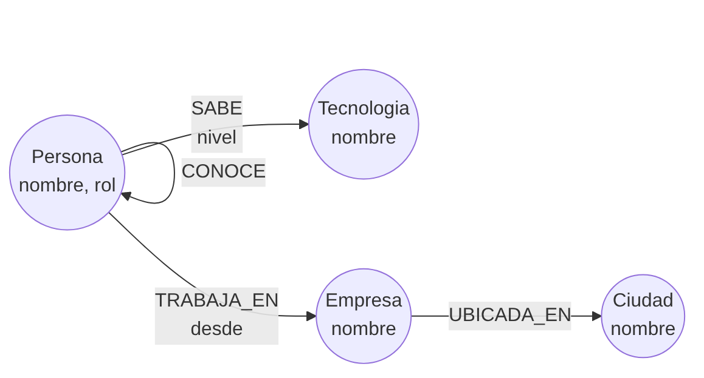
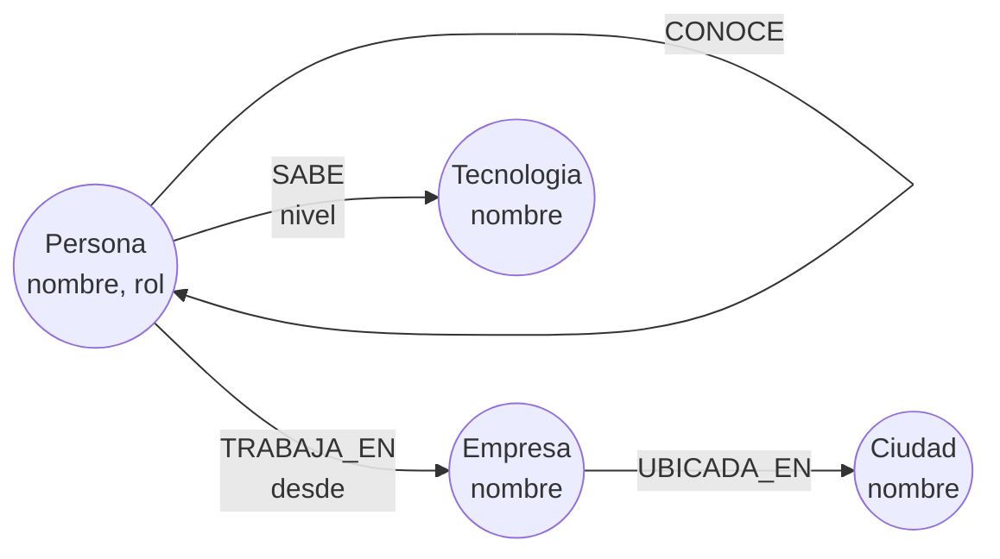

# Punto 4 — Amazon Neptune

Despliegue de Amazon Neptune en `us-east-2` (Ohio) con una instancia aprovisionada y **endpoint público**, consulta desde el computador local con Python y autenticación IAM, y carga de un grafo con 14 vértices y 24 relaciones consultado con openCypher. No se usa EC2 ni túnel SSH.

## Contenido

| Archivo | Descripción |
|---|---|
| `despliegue_p4.sh` | Crea, muestra y elimina la infraestructura con AWS CLI (`crear`, `estado`, `destruir`) |
| `precios_neptune.py` | Consulta los precios de Neptune en Ohio con la API de precios de AWS |
| `neptune_grafo.py` | Carga el grafo y ejecuta las tres consultas desde el computador local |
| `diagrama_arquitectura.png`, `modelo_grafo.png` | Arquitectura de acceso y modelo del grafo |
| `evidencias/` | Salidas de creación, consultas, petición sin firma y eliminación (ID de cuenta enmascarado) |

## Costos

Precios bajo demanda en Ohio, consultados con `precios_neptune.py` el 2026-11-09:

| Opción | Por hora | Por semana | Por mes |
|---|---|---|---|
| Serverless, 1 NCU (mínimo) | $0,1608 | $27,01 | $117,38 |
| **`db.t4g.medium`** | **$0,0930** | **$15,62** | **$67,89** |
| EC2 del túnel (si se hubiera usado) | $0,0163 | $2,74 | $11,90 |

| Otros cargos | Precio |
|---|---|
| Almacenamiento estándar | ≈ $0,10 por GB-mes |
| I/O estándar | $0,20 por millón de solicitudes |
| Endpoint público | Sin costo adicional |

Costo de la práctica: los recursos estuvieron activos de 15:05 a 17:03, unas 1,97 horas, por un total aproximado de **0,18 dólares**, casi todo de cómputo. Con Serverless en su mínimo habría costado unos 0,32 dólares, y con un túnel SSH se habrían sumado unos 3 centavos.

## Arquitectura de acceso





| Componente | Configuración |
|---|---|
| VPC | VPC por defecto de `us-east-2` |
| Subredes | Las tres subredes por defecto, una por zona de disponibilidad, en el grupo de subredes `fp-taller-p4-subnets` |
| Rutas | La tabla principal tiene `0.0.0.0/0 → igw-00e2ef58ebacfbffc`; el script lo comprueba antes de crear nada |
| Grupo de seguridad | `fp-taller-p4-sg-neptune`: entrada TCP 8182 solo desde la IP pública del estudiante (`/32`) |
| Endpoint | `--publicly-accessible` en la instancia; el endpoint del clúster resuelve a una IP pública |
| Cifrado | HTTPS (TLS) en el tránsito y almacenamiento cifrado en reposo |
| Autenticación | IAM obligatoria (`--enable-iam-database-authentication`); `neptunedata` firma cada petición con SigV4 |

La seguridad funciona en dos capas. El grupo de seguridad bloquea cualquier conexión que no venga de la IP del estudiante, e IAM rechaza cualquier petición que no esté firmada por una identidad autorizada. La segunda capa se comprobó con una petición sin firma, que Neptune rechazó aunque venía de la IP permitida:

```
$ curl -s https://<endpoint>:8182/status
{"code":"AccessDeniedException","detailedMessage":"Missing Authentication Token", ...}
```

## Modelo del grafo





Es una red profesional pequeña:

| Vértices | Cantidad | Valores |
|---|---|---|
| Persona | 6 | Ana, Luis, María, Carlos, Sofía, Jorge |
| Empresa | 2 | DataCo (Bogotá), CloudLab (Medellín) |
| Ciudad | 2 | Bogotá, Medellín |
| Tecnologia | 4 | Python, SQL, AWS, Spark |
| **Total** | **14** | |

| Relaciones | Cantidad | Propiedades |
|---|---|---|
| `CONOCE` | 5 | — |
| `TRABAJA_EN` | 6 | `desde` (año) |
| `UBICADA_EN` | 2 | — |
| `SABE` | 11 | `nivel` (básico, intermedio, avanzado) |
| **Total** | **24** | |

## Reproducción

**Requisitos.** AWS CLI reciente (con soporte de `--publicly-accessible` para Neptune) y Python 3 con `boto3`, con las credenciales de `user_cli` en el perfil `default` y la región `us-east-2`. La cuenta debe estar en el plan de pago de AWS, porque Neptune no está disponible en el plan gratuito.

**1. Infraestructura.** El script detecta la IP pública del computador para la regla del grupo de seguridad.
```bash
bash despliegue_p4.sh crear
```

**2. Grafo y consultas.** El programa obtiene el endpoint del clúster, borra el grafo, lo vuelve a cargar y ejecuta las consultas.
```bash
python3 neptune_grafo.py
```

**3. Eliminación**
```bash
bash despliegue_p4.sh destruir
```

## Consultas y resultados

La salida completa está en `evidencias/p4_python.txt`.

**1. Amigos de amigos de Ana que todavía no conoce.** Recorre dos saltos por `CONOCE`, en cualquier dirección, y descarta a quienes ya son amigos directos de Ana.
```cypher
MATCH (a:Persona {nombre: 'Ana'})-[:CONOCE]-(amigo:Persona)
WITH a, collect(amigo) AS amigos
MATCH (a)-[:CONOCE]-(intermedio:Persona)-[:CONOCE]-(sugerido:Persona)
WHERE sugerido <> a AND NOT sugerido IN amigos
RETURN sugerido.nombre AS sugerido, collect(DISTINCT intermedio.nombre) AS a_traves_de
ORDER BY sugerido
```
| Sugerido | A través de |
|---|---|
| Carlos | Luis |
| Jorge | María |

Ana conoce directamente a Luis y a María. A través de ellos llega a Carlos y a Jorge, que serían sus sugerencias de contacto, como en una red social profesional.

**2. Personas de empresas ubicadas en Bogotá y sus tecnologías.** Recorre tres saltos: Ciudad ← Empresa ← Persona → Tecnología.
```cypher
MATCH (c:Ciudad {nombre: 'Bogotá'})<-[:UBICADA_EN]-(e:Empresa)<-[:TRABAJA_EN]-(p:Persona)-[s:SABE]->(t:Tecnologia)
RETURN e.nombre AS empresa, p.nombre AS persona,
       collect(t.nombre + ' (' + s.nivel + ')') AS tecnologias
ORDER BY persona
```
| Empresa | Persona | Tecnologías |
|---|---|---|
| DataCo | Ana | Python (avanzado), SQL (avanzado) |
| DataCo | Luis | SQL (intermedio) |
| DataCo | María | Python (avanzado), AWS (intermedio), Spark (intermedio) |

DataCo es la única empresa en Bogotá. Su equipo cubre las cuatro tecnologías del grafo, y María es la persona con el perfil más amplio.

**3. Tecnologías que saben los colegas de Luis y que Luis no sabe.** Excluye las tecnologías propias de Luis y cuenta cuántos colegas de su misma empresa dominan cada una de las restantes.
```cypher
MATCH (l:Persona {nombre: 'Luis'})-[:SABE]->(propia:Tecnologia)
WITH l, collect(propia) AS propias
MATCH (l)-[:TRABAJA_EN]->(:Empresa)<-[:TRABAJA_EN]-(colega:Persona)-[:SABE]->(t:Tecnologia)
WHERE colega <> l AND NOT t IN propias
RETURN t.nombre AS tecnologia, count(DISTINCT colega) AS colegas,
       collect(DISTINCT colega.nombre) AS quienes
ORDER BY colegas DESC, tecnologia
```
| Tecnología | Colegas | Quiénes |
|---|---|---|
| Python | 2 | María, Ana |
| AWS | 1 | María |
| Spark | 1 | María |

Python es la recomendación más fuerte para Luis, porque dos de sus colegas la dominan y podrían enseñársela. Este tipo de recomendación por vecindad es uno de los casos de uso típicos de una base de datos de grafos.

## Evidencias

| Evidencia | Archivo |
|---|---|
| Creación (clúster disponible, IAM activada, instancia pública) | `evidencias/p4_crear.txt` |
| Carga del grafo y consultas | `evidencias/p4_python.txt` |
| Petición sin firma rechazada por IAM | `evidencias/p4_sin_firma.txt` |
| Eliminación y verificación | `evidencias/p4_destruir.txt` |

La verificación posterior a la eliminación devolvió listas vacías para clústeres de Neptune, snapshots de clúster y el grupo de seguridad del punto 4. Como evidencia de la creación se usa la salida del script, que consulta directamente la API de Neptune, porque no se tomaron capturas de la consola antes de eliminar el clúster.
