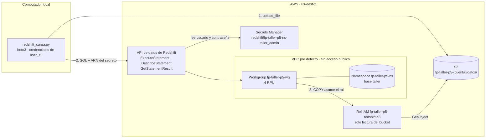
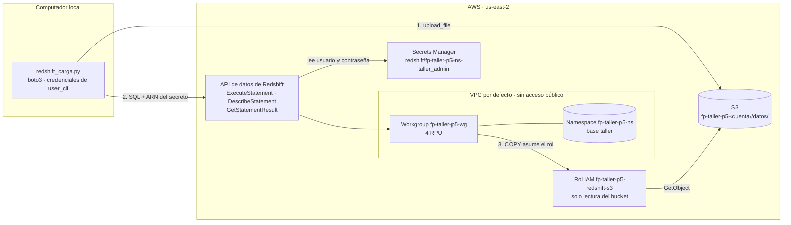
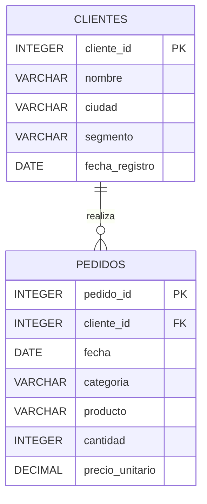
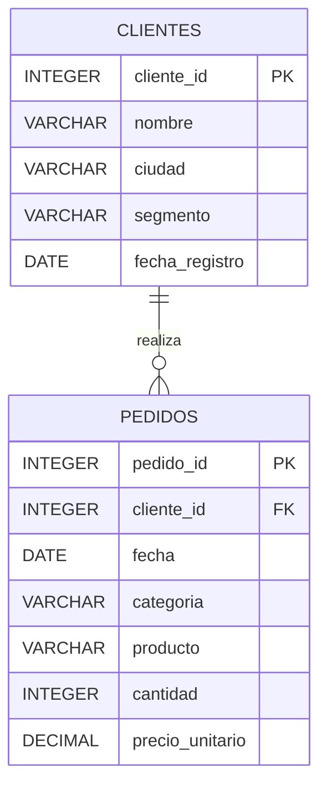

# Punto 5 — Amazon Redshift

Despliegue de Amazon Redshift Serverless en `us-east-2` (Ohio), con la contraseña de administración administrada en AWS Secrets Manager y un rol de IAM que permite a Redshift leer archivos de S3. Un programa en Python sube dos tablas relacionadas a S3, las crea en Redshift, las carga con `COPY` y ejecuta consultas con filtro, unión y agregación. Todas las instrucciones SQL se envían con la API de datos de Redshift.

## Contenido

| Archivo | Descripción |
|---|---|
| `despliegue_p5.sh` | Crea, muestra y elimina la infraestructura con AWS CLI (`crear`, `estado`, `destruir`) |
| `precios_redshift.py` | Consulta los precios de Redshift en Ohio con la API de precios de AWS |
| `redshift_carga.py` | Sube los CSV, crea las tablas, ejecuta el `COPY` y las consultas con la API de datos |
| `datos/clientes.csv`, `datos/pedidos.csv` | Conjunto de datos (12 clientes, 40 pedidos) |
| `diagrama_arquitectura.png`, `modelo_datos.png` | Arquitectura y modelo de datos |
| `evidencias/` | Salidas de creación, carga, consultas, consumo y eliminación (ID de cuenta enmascarado) |

## Costos

Precios bajo demanda en Ohio, consultados con `precios_redshift.py` el 2026-11-09:

| Opción | Cómo cobra | Precio |
|---|---|---|
| **Serverless, 4 RPU** | Por segundo de consultas activas, mínimo 60 s | $0,36 por RPU-hora → **$1,44 por hora activa** |
| `dc2.large` | Por hora encendida, por nodo | $0,25 por hora |
| `ra3.large` | Por hora encendida, por nodo | $0,543 por hora |
| Redshift Managed Storage | Por GB al mes | $0,024 |
| Instantáneas de Serverless | Por GB al mes | $0,023 |
| Secreto de Secrets Manager | Por mes, prorrateado | $0,40 |

| Escenario | Serverless 4 RPU | `dc2.large` | `ra3.large` |
|---|---|---|---|
| Esta práctica (≈ 1 h de recursos, 1 min de cómputo) | **$0,024** medido | $0,25 | $0,54 |
| Una semana sin consultas | $0 de cómputo | $42,00 | $91,22 |
| Una hora de consultas continuas | $1,44 | $0,25 | $0,54 |

El costo medido proviene de la vista `sys_serverless_usage` (`evidencias/p5_consumo.txt`). Serverless solo resulta más caro si se mantiene ocupado durante buena parte de cada hora, que no es el caso de este taller.

## Arquitectura





El programa nunca ve la contraseña de Redshift: envía cada instrucción a la API de datos junto con el ARN del secreto, y es la API la que lee las credenciales de Secrets Manager. Para el `COPY`, Redshift asume el rol `fp-taller-p5-redshift-s3`, cuya relación de confianza solo admite a los servicios `redshift.amazonaws.com` y `redshift-serverless.amazonaws.com` y cuya política solo permite `s3:ListBucket`, `s3:GetBucketLocation` y `s3:GetObject` sobre el bucket del punto. Así, Redshift lee S3 sin claves de acceso.

## Conjunto de datos





`clientes.csv` tiene 12 clientes de Bogotá, Medellín, Cali y Barranquilla, de los segmentos Persona y Empresa. `pedidos.csv` tiene 40 pedidos entre julio y octubre de 2026, de las categorías Tecnología, Hogar, Deportes y Libros. Cada pedido pertenece a un cliente mediante `cliente_id`.

## Reproducción

**Requisitos.** AWS CLI y Python 3 con `boto3`, con las credenciales de `user_cli` en el perfil `default` y la región `us-east-2`. La cuenta debe estar en el plan de pago de AWS, porque Redshift no está disponible en el plan gratuito.

**1. Infraestructura**
```bash
bash despliegue_p5.sh crear
```
Crea el bucket, el rol de IAM con su política de solo lectura, un grupo de seguridad sin reglas de entrada, el namespace con `--manage-admin-password` y el rol asociado como predeterminado, y el workgroup de 4 RPU sin acceso público.

**2. Carga y consultas.** Con los CSV en `datos/`:
```bash
python3 redshift_carga.py
```

**3. Eliminación**
```bash
bash despliegue_p5.sh destruir
```

## Instrucciones de carga

El programa obtiene del namespace el ARN del secreto y el del rol, sube los archivos a `s3://fp-taller-p5-<cuenta>/datos/` y ejecuta, una por una, las siguientes instrucciones. Para cada una llama a `ExecuteStatement`, consulta `DescribeStatement` hasta que el estado sea `FINISHED`, `FAILED` o `ABORTED`, y si hay filas las recupera con `GetStatementResult`.

```sql
CREATE TABLE clientes (
    cliente_id     INTEGER     NOT NULL PRIMARY KEY,
    nombre         VARCHAR(60) NOT NULL,
    ciudad         VARCHAR(30) NOT NULL,
    segmento       VARCHAR(20) NOT NULL,
    fecha_registro DATE        NOT NULL
)
DISTSTYLE ALL;

CREATE TABLE pedidos (
    pedido_id       INTEGER       NOT NULL PRIMARY KEY,
    cliente_id      INTEGER       NOT NULL REFERENCES clientes (cliente_id),
    fecha           DATE          NOT NULL,
    categoria       VARCHAR(20)   NOT NULL,
    producto        VARCHAR(40)   NOT NULL,
    cantidad        INTEGER       NOT NULL,
    precio_unitario DECIMAL(12,2) NOT NULL
)
DISTKEY (cliente_id)
SORTKEY (fecha);

COPY clientes FROM 's3://fp-taller-p5-<cuenta>/datos/clientes.csv'
IAM_ROLE 'arn:aws:iam::<cuenta>:role/fp-taller-p5-redshift-s3'
FORMAT AS CSV IGNOREHEADER 1 REGION 'us-east-2';

COPY pedidos FROM 's3://fp-taller-p5-<cuenta>/datos/pedidos.csv'
IAM_ROLE 'arn:aws:iam::<cuenta>:role/fp-taller-p5-redshift-s3'
FORMAT AS CSV IGNOREHEADER 1 REGION 'us-east-2';
```

`clientes` usa `DISTSTYLE ALL` porque es pequeña y se une con todo: se guarda una copia completa en cada nodo y las uniones no necesitan mover datos. `pedidos` se distribuye por `cliente_id`, la columna de unión, y se ordena por `fecha`, que es la columna por la que se filtra. En Redshift, las claves primarias y foráneas son informativas: el optimizador las usa, pero no las hace cumplir.

Tras la carga, un conteo confirmó 12 filas en `clientes` y 40 en `pedidos`. La API de datos informa 0 filas afectadas para el `COPY`, que es su comportamiento normal con esta instrucción.

## Consultas y resultados

La salida completa está en `evidencias/p5_python.txt`. Las primeras instrucciones tardaron entre 8 y 11 segundos porque el workgroup estaba inactivo y Redshift tuvo que asignarle cómputo (arranque en frío); las siguientes tardaron menos de un segundo.

**1. Filtro.** ¿Qué compras grandes de tecnología hubo en septiembre y octubre?
```sql
SELECT pedido_id, fecha, producto, cantidad, cantidad * precio_unitario AS total
FROM pedidos
WHERE categoria = 'Tecnología'
  AND fecha BETWEEN '2026-09-01' AND '2026-10-31'
  AND cantidad * precio_unitario > 2000000
ORDER BY total DESC;
```
| Pedido | Fecha | Producto | Cantidad | Total |
|---|---|---|---|---|
| 5036 | 2026-10-22 | Portátil | 2 | 6.400.000 |
| 5026 | 2026-09-27 | Monitor | 4 | 3.560.000 |

Solo dos pedidos de tecnología superaron los dos millones en esos meses, mientras que en julio dos pedidos de portátiles sumaron 22,4 millones, lo que anticipa la caída de la categoría que muestra la cuarta consulta.

**2. Unión.** ¿Quiénes hicieron los pedidos más grandes y de dónde son?
```sql
SELECT p.pedido_id, p.fecha, c.nombre, c.ciudad, c.segmento, p.producto,
       p.cantidad * p.precio_unitario AS total
FROM pedidos p
JOIN clientes c ON c.cliente_id = p.cliente_id
ORDER BY total DESC
LIMIT 10;
```
| Pedido | Fecha | Cliente | Ciudad | Segmento | Producto | Total |
|---|---|---|---|---|---|---|
| 5002 | 2026-07-05 | Laura Vargas | Bogotá | Persona | Portátil | 12.800.000 |
| 5006 | 2026-07-17 | Andrés Castro | Cali | Persona | Portátil | 9.600.000 |
| 5036 | 2026-10-22 | Jorge Herrera | Medellín | Empresa | Portátil | 6.400.000 |
| 5034 | 2026-10-17 | Andrés Castro | Cali | Persona | Bicicleta | 5.800.000 |
| 5012 | 2026-08-14 | Daniel Ortiz | Cali | Empresa | Bicicleta | 5.800.000 |
| 5004 | 2026-07-15 | Daniel Ortiz | Cali | Empresa | Bicicleta | 4.350.000 |
| 5026 | 2026-09-27 | Luis Pérez | Medellín | Persona | Monitor | 3.560.000 |
| 5035 | 2026-10-19 | Felipe Moreno | Barranquilla | Empresa | Bicicleta | 2.900.000 |
| 5032 | 2026-10-14 | Luis Pérez | Medellín | Persona | Aspiradora | 2.600.000 |
| 5014 | 2026-08-16 | Carlos Díaz | Bogotá | Persona | Bicicleta | 1.450.000 |

Portátiles y bicicletas ocupan siete de los diez primeros lugares. Dos clientes de Cali, Andrés Castro y Daniel Ortiz, aparecen dos veces cada uno, lo que explica por qué Cali lidera las ventas en la siguiente consulta.

**3. Agregación con unión.** ¿Dónde y en qué tipo de cliente se concentran las ventas?
```sql
SELECT c.ciudad, c.segmento,
       COUNT(*) AS pedidos,
       SUM(p.cantidad) AS unidades,
       SUM(p.cantidad * p.precio_unitario) AS ventas,
       ROUND(AVG(p.cantidad * p.precio_unitario)) AS ticket_promedio
FROM pedidos p
JOIN clientes c ON c.cliente_id = p.cliente_id
GROUP BY c.ciudad, c.segmento
ORDER BY ventas DESC;
```
| Ciudad | Segmento | Pedidos | Unidades | Ventas | Ticket promedio |
|---|---|---|---|---|---|
| Cali | Persona | 5 | 13 | 16.120.000 | 3.224.000 |
| Bogotá | Persona | 5 | 15 | 15.390.000 | 3.078.000 |
| Cali | Empresa | 4 | 11 | 10.575.000 | 2.643.750 |
| Medellín | Empresa | 6 | 12 | 9.040.000 | 1.506.667 |
| Medellín | Persona | 7 | 18 | 7.865.000 | 1.123.571 |
| Barranquilla | Empresa | 6 | 16 | 5.620.000 | 936.667 |
| Barranquilla | Persona | 3 | 10 | 1.290.000 | 430.000 |
| Bogotá | Empresa | 4 | 8 | 945.000 | 236.250 |

Cali es la ciudad con más ventas, 26,7 millones sumando ambos segmentos, seguida de Medellín (16,9) y Bogotá (16,3). El segmento Persona concentra el 61 % de las ventas, con tickets promedio más altos. Bogotá muestra el mayor contraste: sus clientes Persona compran por más de 15 millones, mientras que sus Empresas apenas superan los 900 mil.

**4. Agregación por tiempo.** ¿Cómo evolucionan las ventas de cada categoría mes a mes?
```sql
SELECT TO_CHAR(fecha, 'YYYY-MM') AS mes, categoria,
       COUNT(*) AS pedidos,
       SUM(cantidad * precio_unitario) AS ventas
FROM pedidos
GROUP BY 1, 2
ORDER BY 1, ventas DESC;
```
| Mes | Categoría | Pedidos | Ventas |
|---|---|---|---|
| 2026-07 | Tecnología | 4 | 23.890.000 |
| 2026-07 | Deportes | 4 | 5.070.000 |
| 2026-07 | Hogar | 1 | 660.000 |
| 2026-08 | Deportes | 2 | 7.250.000 |
| 2026-08 | Tecnología | 3 | 900.000 |
| 2026-08 | Libros | 2 | 130.000 |
| 2026-09 | Tecnología | 4 | 5.940.000 |
| 2026-09 | Hogar | 1 | 880.000 |
| 2026-09 | Libros | 3 | 610.000 |
| 2026-09 | Deportes | 2 | 450.000 |
| 2026-10 | Deportes | 5 | 9.600.000 |
| 2026-10 | Tecnología | 3 | 7.300.000 |
| 2026-10 | Hogar | 3 | 3.480.000 |
| 2026-10 | Libros | 3 | 685.000 |

Julio fue el mejor mes, con 29,6 millones, impulsado por dos pedidos de portátiles que suman 22,4 millones. Agosto y septiembre cayeron a 8,3 y 7,9 millones, y octubre se recuperó hasta 21,1 millones, con Deportes como la categoría líder del mes. Tecnología depende de pocos pedidos de alto valor, mientras que Deportes crece de forma más sostenida.

## Evidencias

| Evidencia | Archivo |
|---|---|
| Creación (namespace, secreto administrado, workgroup, rol, bucket) | `evidencias/p5_crear.txt` |
| Subida, tablas, `COPY` y consultas | `evidencias/p5_python.txt` |
| Cómputo cobrado según `sys_serverless_usage` | `evidencias/p5_consumo.txt` |
| Eliminación y verificación | `evidencias/p5_destruir.txt` |

La verificación posterior a la eliminación devolvió listas vacías para workgroups, namespaces, instantáneas de Redshift Serverless y secretos de Secrets Manager. El rol de IAM ya no existe (`NoSuchEntity`) y no queda ningún bucket del punto 5.
