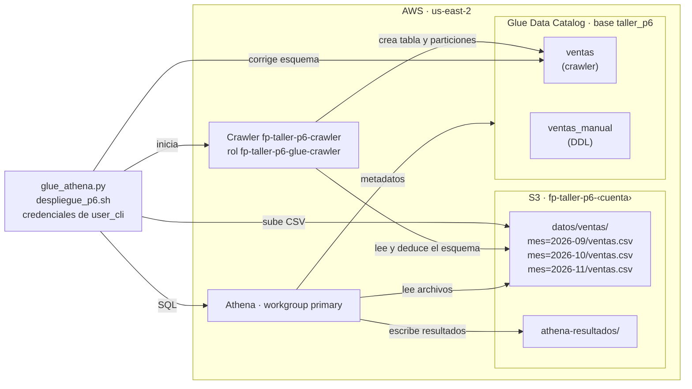

# Punto 6 — AWS Glue Data Catalog y Amazon Athena

Catalogación de un CSV de ventas particionado por mes en S3 con un crawler de AWS Glue, corrección del esquema inferido, consultas con Athena, actualización del catálogo al agregar registros y comparación con una tabla creada manualmente. Todo en `us-east-2` (Ohio), autorizado únicamente con IAM.

## Contenido

| Archivo | Descripción |
|---|---|
| `despliegue_p6.sh` | Crea, ejecuta y elimina los recursos con AWS CLI (`crear`, `crawler`, `agregar`, `estado`, `destruir`) |
| `glue_athena.py` | Corrige el esquema y ejecuta las consultas (`muestra`, `corregir`, `consultas`, `manual`) |
| `datos/ventas/mes=2026-09/`, `mes=2026-10/` | 24 registros iniciales |
| `datos_nuevos/ventas/mes=2026-11/` | 8 registros para la prueba de actualización |
| `diagrama_arquitectura.png` | Arquitectura |
| `evidencias/` | Salidas de cada paso (ID de cuenta enmascarado) |

## Costos

| Componente | Precio | Uso en la práctica | Costo aproximado |
|---|---|---|---|
| Crawler | $0,44 por DPU-hora, mínimo 10 min por ejecución | 3 ejecuciones de unos 38 s | $0,07–0,15 por ejecución |
| Data Catalog | Gratis hasta 1 M de objetos y de solicitudes al mes | 2 tablas y 6 particiones | $0 |
| Athena | $5 por TB escaneado, mínimo 10 MB por consulta; DDL gratis | 13 consultas de menos de 3 KB | < $0,001 |
| S3 | ≈ $0,023 por GB-mes | 3 archivos (2,7 KB) y resultados de Athena | ≈ $0 |

Los precios de referencia son los de `us-east-1`; para Ohio pueden verificarse en la calculadora de AWS. Glue y Athena están disponibles en el plan gratuito de AWS.

## Arquitectura




El crawler asume el rol `fp-taller-p6-glue-crawler`, que tiene la política administrada `AWSGlueServiceRole` y una política en línea que solo permite listar el bucket y leer `datos/`. El crawler está configurado con `UpdateBehavior=LOG`, para no sobrescribir el esquema corregido, y con `AddOrUpdateBehavior=InheritFromTable`, para que las particiones nuevas hereden el esquema de la tabla.

## Datos

El archivo es un registro de ventas con 10 columnas:

| Columna | Ejemplo | Tipo correcto |
|---|---|---|
| `venta_id` | 7001 | `bigint` |
| `fecha` | 2026-09-04 | `date` |
| `ciudad` | Medellín | `string` |
| `codigo_postal` | 050001 | `string` |
| `categoria` | Hogar | `string` |
| `producto` | Aspiradora | `string` |
| `cantidad` | 1 | `int` |
| `precio_unitario` | 650000 | `bigint` |
| `metodo_pago` | transferencia | `string` |
| `devuelto` | false | `boolean` |

Los archivos están organizados en carpetas con el formato `mes=AAAA-MM`, que Glue y Athena reconocen como la columna de partición `mes`. Septiembre y octubre tienen 12 registros cada uno; noviembre tiene 8 y se agrega después para probar la actualización del catálogo. Las columnas `fecha` y `codigo_postal` están pensadas para poner a prueba la inferencia del crawler.

## Reproducción

**Requisitos.** AWS CLI y Python 3 con `boto3`, con las credenciales de `user_cli` en el perfil `default` y la región `us-east-2`.

```bash
bash despliegue_p6.sh crear            # bucket, rol, base de datos, crawler y primera ejecución
python3 glue_athena.py muestra         # tipos que usa Athena antes de corregir
python3 glue_athena.py corregir        # corrige la tabla y sus particiones
python3 glue_athena.py muestra         # tipos después de corregir
python3 glue_athena.py consultas       # filtro, agrupación y conteo por mes
bash despliegue_p6.sh agregar          # sube noviembre
python3 glue_athena.py consultas       # noviembre todavía no aparece
bash despliegue_p6.sh crawler          # registra la partición nueva
python3 glue_athena.py consultas       # noviembre ya aparece
python3 glue_athena.py manual          # tabla creada con DDL y comparación
bash despliegue_p6.sh destruir
```

## Esquema inferido y corrección

| Columna | Inferido por el crawler | Corregido | Motivo |
|---|---|---|---|
| `fecha` | `string` | `date` | Son fechas ISO; como texto no admiten funciones ni comparaciones de fecha |
| `codigo_postal` | `bigint` | `string` | Es un identificador; como número pierde el cero inicial |

El resto de columnas quedó bien inferido. La corrección se hizo con `UpdateTable` sobre la tabla y `BatchUpdatePartition` sobre sus particiones. Una muestra consultada en Athena antes y después muestra el efecto:

| `venta_id` | `fecha` antes | `fecha` después | `codigo_postal` antes | `codigo_postal` después |
|---|---|---|---|---|
| 7001 | 2026-09-04 (`varchar`) | 2026-09-04 (`date`) | 50001 (`bigint`) | 050001 (`varchar`) |
| 7003 | 2026-09-11 (`varchar`) | 2026-09-11 (`date`) | 80001 (`bigint`) | 080001 (`varchar`) |

## Consultas y resultados

**1. Filtro.** Ventas de Tecnología no devueltas de más de un millón.
```sql
SELECT venta_id, fecha, ciudad, codigo_postal, producto, cantidad,
       cantidad * precio_unitario AS total
FROM ventas
WHERE categoria = 'Tecnología' AND NOT devuelto AND cantidad * precio_unitario > 1000000
ORDER BY total DESC;
```

**2. Agrupación.** Ventas y devoluciones por ciudad.
```sql
SELECT ciudad, codigo_postal, COUNT(*) AS ventas,
       SUM(cantidad * precio_unitario) AS total,
       SUM(CASE WHEN devuelto THEN 1 ELSE 0 END) AS devoluciones
FROM ventas
GROUP BY ciudad, codigo_postal
ORDER BY total DESC;
```

Resultados con los 24 registros iniciales (`evidencias/p6_consultas.txt`):

| Venta | Fecha | Ciudad | Código postal | Producto | Cantidad | Total |
|---|---|---|---|---|---|---|
| 7012 | 2026-09-28 | Cali | 760001 | Monitor | 4 | 3.560.000 |
| 7015 | 2026-10-15 | Barranquilla | 080001 | Monitor | 2 | 1.780.000 |
| 7004 | 2026-09-17 | Bogotá | 110111 | Monitor | 2 | 1.780.000 |

| Ciudad | Código postal | Ventas | Total | Devoluciones |
|---|---|---|---|---|
| Cali | 760001 | 7 | 14.090.000 | 1 |
| Bogotá | 110111 | 5 | 14.075.000 | 1 |
| Barranquilla | 080001 | 7 | 13.300.000 | 0 |
| Medellín | 050001 | 5 | 1.940.000 | 0 |

En septiembre y octubre, las ventas grandes de tecnología no devueltas fueron solo monitores. Cali, Bogotá y Barranquilla vendieron cifras muy parecidas, mientras que Medellín quedó muy por debajo.

## Actualización del catálogo

Se subió el archivo de noviembre y se ejecutó el conteo por partición antes y después de volver a ejecutar el crawler (`evidencias/p6_actualizacion.txt`):

| Momento | Archivo de noviembre en S3 | Partición registrada | Registros | Bytes escaneados |
|---|---|---|---|---|
| Inicial | No | No | 24 | 1.997 |
| Archivo subido, sin crawler | Sí | No | 24 | 1.997 |
| Después del crawler | Sí | Sí | 32 | 2.724 |

Athena solo lee las particiones registradas en el catálogo, por eso no vio noviembre hasta que el crawler registró `mes=2026-11`. El crawler informó cero tablas creadas y cero actualizadas, porque no modificó el esquema, pero agregó la partición, que heredó los tipos corregidos: noviembre muestra `fecha` como `date` y el código postal `050001` con su cero. Con los 32 registros, el filtro pasó de 3 a 5 ventas, encabezadas por un pedido de cuatro portátiles en Cali por 12,8 millones, y Cali se separó como la ciudad con más ventas, con 27,1 millones.

## Crawler frente a tabla manual

```sql
CREATE EXTERNAL TABLE ventas_manual (
    venta_id BIGINT, fecha DATE, ciudad STRING, codigo_postal STRING,
    categoria STRING, producto STRING, cantidad INT, precio_unitario BIGINT,
    metodo_pago STRING, devuelto BOOLEAN
)
PARTITIONED BY (mes STRING)
ROW FORMAT DELIMITED FIELDS TERMINATED BY ','
STORED AS TEXTFILE
LOCATION 's3://fp-taller-p6-<cuenta>/datos/ventas/'
TBLPROPERTIES ('skip.header.line.count' = '1');

MSCK REPAIR TABLE ventas_manual;
```

| | Crawler (`ventas`) | Manual (`ventas_manual`) |
|---|---|---|
| Creada por | `AWS-Crawler` | `user_cli` |
| Esquema | Deducido; 2 columnas corregidas a mano | Definido desde el inicio |
| `cantidad` | `bigint` | `int` |
| Particiones nuevas | Al volver a ejecutar el crawler | `MSCK REPAIR TABLE` registró las 3 |
| Costo de creación | Mínimo 10 min de crawler | 0 bytes escaneados, gratis |
| Resultado | 32 registros | 32 registros |

Las dos tablas apuntan a los mismos archivos y usan el mismo `LazySimpleSerDe`: son dos descripciones distintas de los mismos datos.

## Problemas encontrados

**Archivos `Zone.Identifier`.** Los CSV se descargaron en Windows y se copiaron a WSL, donde la marca de origen que Windows agrega a las descargas apareció como un archivo adicional por cada CSV. Se subieron al bucket, y el crawler, al encontrar dos archivos con estructuras distintas en cada partición, creó cuatro tablas en lugar de una tabla particionada (`evidencias/p6_crear_intento1.txt`). Se eliminaron esos archivos del computador y de S3, se borraron las cuatro tablas y se volvió a ejecutar el crawler (`evidencias/p6_crawler1.txt`). El script de esta entrega solo sube archivos `.csv` y el crawler excluye `**Zone.Identifier`.

## Evidencias

| Evidencia | Archivo |
|---|---|
| Primer intento con los archivos de Windows | `evidencias/p6_crear_intento1.txt` |
| Limpieza y crawler correcto | `evidencias/p6_crawler1.txt` |
| Esquema inferido | `evidencias/p6_esquema_inferido.txt` |
| Corrección y muestras antes y después | `evidencias/p6_corregir.txt` |
| Consultas iniciales | `evidencias/p6_consultas.txt` |
| Actualización del catálogo | `evidencias/p6_actualizacion.txt` |
| Tabla manual y comparación | `evidencias/p6_manual.txt` |
| Eliminación y verificación | `evidencias/p6_destruir.txt` |

La verificación posterior a la eliminación devolvió listas vacías para la base de datos del catálogo y los crawlers. El rol ya no existe (`NoSuchEntity`) y no queda ningún bucket del punto 6.
